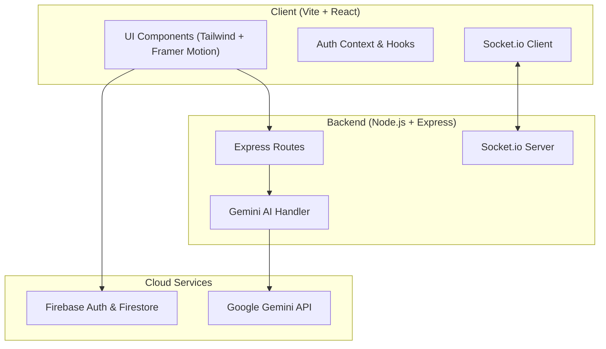

# LocalConnect Project Architecture

LocalConnect is a modern travel platform designed to connect travelers with verified local guides for authentic city experiences. The application features a high-end, dynamic UI and integrates real-time communication and AI-powered assistance.

---

## 🏗️ High-Level Architecture

---

## 🛠️ Technology Stack

### Frontend
- **Framework:** React 18 (Vite)
- **Styling:** Tailwind CSS (Utility-first, responsive design)
- **Animations:** Framer Motion (Scroll-triggered animations, magnetic effects, 3D tilt)
- **Icons:** Lucide-React
- **Routing:** React Router DOM

### Backend
- **Runtime:** Node.js
- **Framework:** Express.js
- **Real-time:** Socket.io (for instant messaging and notifications)
- **AI Library:** `@google/genai` (Google Generative AI SDK)

### Database & Auth
- **Authentication:** Firebase Auth (Email/Password, Social login support)
- **Database:** Firestore (NoSQL document store for users, messages, and local data)
- **Storage:** Firebase Storage (for profile images and city assets)

---

## 📂 Project Structure

### Root Directory
- `/src`: Frontend React application.
- `/server`: Node.js backend server.
- `/public`: Static assets (logos, fallback images).
- `tailwind.config.js`: Custom theme configuration (colors, animations).

### Frontend Layout (`/src`)
- `components/`:
  - `ai/`: AIAssistant UI and chat logic.
  - `common/`: Reusable UI elements (Buttons, Cards, Navbar, Footer).
  - `dashboard/`: User-specific interfaces for Locals and Travelers.
- `pages/`: Page-level components (Home, Explore, Chat, CityPage, Profile).
- `data/`: Mock data for development and initial city listings.
- `firebase/`: Firebase initialization and configuration.
- `context/`: Global state management (AuthContext).

### Backend Layout (`/server`)
- `index.js`: Main entry point, Express setup, and Socket.io handlers.
- `.env`: Environment variables (GEMINI_API_KEY, PORT).

---

## ✨ Key Features & Implementation Details

### 1. Premium UI/UX
- **Glassmorphism:** Intensive use of backdrop-blur and semi-transparent layers for a modern "Apple-style" aesthetic.
- **Micro-interactions:** Magnetic button effects and cursor-following glow implemented via custom React hooks and Framer Motion.
- **Dynamic Backgrounds:** Slowly shifting linear gradients and floating decorative blobs.

### 2. AI Travel Assistant
- **Engine:** Powered by Google's `gemini-2.5-flash-lite` model.
- **Integration:** The frontend communicates with a dedicated `/api/ai/chat` endpoint on the backend, which processes prompts and returns contextually aware travel advice.

### 3. Real-time Communication
- **Socket.io Integration:** Enables instant messaging between travelers and locals without page refreshes.
- **Notification System:** Real-time alerts for new messages or booking inquiries.

### 4. City Discovery
- **Trending Cities:** Dynamic fetching of local guide counts from Firestore.
- **Filtered Exploration:** Ability to browse locals by interest, rating, and language.

---

## 🚀 Deployment Strategy
- **Frontend:** Deployed to **Vercel** with automatic CI/CD from the `main` branch.
- **Backend:** Hosted on **Render** (Web Service), utilizing environment variables for secure API key management.
- **Environment Handling:** Uses `.env` for local development and platform-specific environment variables for production (e.g., `VITE_SOCKET_URL`).
